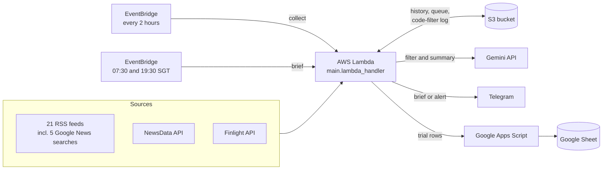
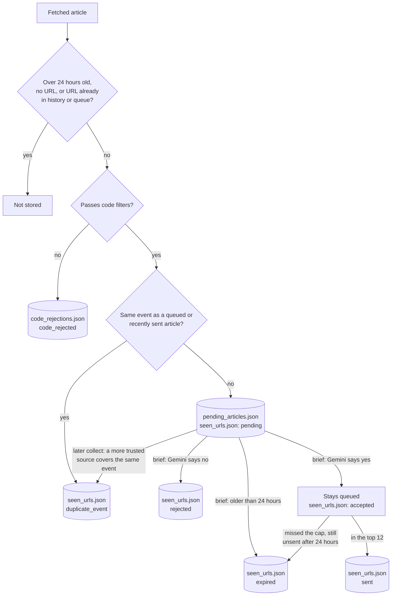
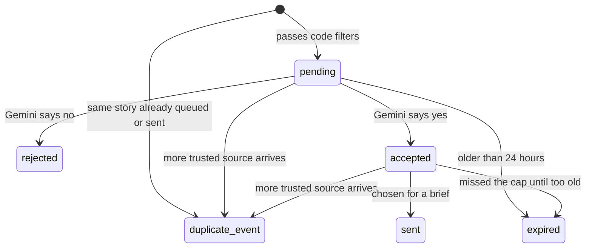

# Bohly's Bread architecture, version 1.1

This document describes how the news brief bot works, how the current trial is set up, and how its ratings will be used to tune the bot into the base MVP.

## 1. Purpose and scope

The bot finds Asia-Pacific news on project finance, banking, energy and commodities, filters it against the client's brief, and delivers it through Telegram.

| Item | Version 1.1 |
|---|---|
| Region | Asia-Pacific only. Each feed has a region tag so Europe, the US and the Middle East can be added later |
| Topics | Infrastructure and project finance; banking and financial markets; energy production and demand; energy and commodity markets |
| Delivery | Morning and evening briefs at 07:30 and 19:30 SGT, with up to 12 articles each |
| Current mode | 7-day trial. Article briefs are paused, articles go to a Google Sheet for rating, and Telegram only receives an alert |

## 2. System overview



The same Lambda function runs in two modes:
- **Collect** fetches and filters articles without calling an LLM.
- **Brief** sends the best queued articles to Gemini, then delivers the result.

After each run that isn't a dry run, the bot adds any new trial articles to the rating sheet.

## 3. Code layout

| File | Responsibility |
|---|---|
| `main.py` | Lambda entry point, collect and brief steps, rating-sheet updates and the local command line |
| `src/feeds.py` | Search queries, Finlight filters and the RSS feed list |
| `src/search_sources.py` | Fetches NewsData, Finlight and RSS, and converts each into one article format |
| `src/ranking.py` | Freshness check, code filters, ranking score, same-event dedupe and shortlist caps |
| `src/llm.py` | Gemini filter and summary prompts, response formats, retries and time limits |
| `src/telegram.py` | Brief formatting, message splitting, sheet alerts and sending |
| `src/storage.py` | Reads and writes state in S3 on AWS, or in `data/` locally |
| `src/trial_data.py` | Shared definitions of trial article groups and spreadsheet columns |
| `src/sheet_sync.py` | Chooses trial articles and sends them to the Google Sheet |
| `src/report.py` | Offline Excel report with per-feed results at every stage |
| `apps_script/Code.gs` | Script inside the Google Sheet that receives rows and builds the summary tabs |
| `scripts/build_lambda.sh` | Builds a Linux-compatible Lambda zip |
| `scripts/deploy.sh` | Tests, builds, uploads and checks a deployment from `main` |
| `tests/` | 96 automated tests, including a simulated Google Sheet for the Apps Script |

## 4. Runtime flows

### 4.1 Collect, every 2 hours

1. **Fetch** all 21 RSS feeds at the same time. NewsData and Finlight are called with the two queries in section 5, if their API keys are set.
2. **Keep fresh articles** published in the last 24 hours. Undated articles count from when they were first seen.
3. **Drop known URLs** already in the history or the queue. URLs are compared after removing tracking parameters.
4. **Score** each article and apply the code filters in section 6. Removed articles go to `code_rejections.json` with the reason.
5. **Drop same-event duplicates**, comparing against the queue and against articles sent in the last 3 days. The most trusted source is kept.
6. **Queue** the survivors in `pending_articles.json` and record them in the history as `pending`.
7. **Retry a failed brief** if one is marked as due.

### 4.2 Brief, at 07:30 and 19:30 SGT

1. Mark the brief as due before starting, so it is retried if AWS stops the run.
2. Drop queued articles that were already sent, and expire those older than 24 hours.
3. Shortlist the top 40 undecided articles by ranking score, with at most 8 per source.
4. Send them to Gemini in two batches of 20. Each decision is saved as soon as its batch finishes.
5. Select the top 12 accepted articles. Any others stay queued and are marked as having missed the cap.
6. Deliver them in one of two ways:
   - **Normal mode:** summarise them with one Gemini call, then send the brief to Telegram.
   - **Trial mode:** skip summaries, record the articles as `sent` with delivery `sheet_only`, and let the sheet update trigger an alert.
7. Clear the due marker.

### 4.3 Rating sheet update, after every run that isn't a dry run

1. Choose every sent article from the 7 trial days, plus up to 3 articles per day from each unsent group.
2. Send them to the Apps Script web app in batches of up to 50.
3. Mark only the articles the sheet confirms as added, so the rest are retried next run.
4. In trial mode, send one Telegram alert after a brief once its articles have reached the sheet.

A problem with the sheet never fails the news run.

## 5. Sources

| Source | How it is queried | Notes |
|---|---|---|
| **RSS feeds** | 16 specialist and regional feeds | Feed list and trust tiers are in `src/feeds.py` |
| **Google News RSS** | 5 searches: project finance, infrastructure M&A, top-tier press, energy markets and Southeast Asia | Publisher name comes from the feed. Descriptions are left empty because they only repeat the headline |
| **NewsData** | `qInMeta` with the two queries below | No country filter. The free plan has a 12-hour delay |
| **Finlight** | The same two queries, limited to 14 APAC country codes | Excludes Yahoo Finance, Seeking Alpha and Benzinga, and the `markets` category. The free plan has a 12-hour delay |

The two API queries are kept under NewsData's 100-character limit:

```text
"project finance" OR "financial close" OR "syndicated loan" OR "green loan" OR refinancing
"transaction banking" OR "infrastructure financing" OR LNG OR commodities
```

Descriptions are cut to 50 words to keep Gemini prompts small.

## 6. Code filters and ranking

### 6.1 Code filters

An article is removed for the first reason that applies:

| Reason | Rule |
|---|---|
| `deny_list` | Earnings calls, webcasts, transcripts, results notices, stock tips, price targets, share consolidations, ratings and share-price moves |
| `not_apac` | The feed isn't tagged APAC, and the title and description name no APAC country, city or major APAC company |
| `low_topic_score` | Topic score below 2 |

### 6.2 Ranking score

Each term counts once:

| Signal | Points |
|---|---|
| Strong finance term, such as "financial close", "green loan" or "OPEC" | +3 each |
| Deal term, such as "loan", "stake" or "acquisition" | +2 each |
| Sector term, such as "LNG", "solar" or "port" | +1 each |
| Contains an amount, such as "$182 million" or "500 MW" | +1 |
| Source trust: top-tier press / specialist trade press / general | +2 / +1 / 0 |

Ties go to the newest article. Every article's score, breakdown and matched terms are saved for tuning.

### 6.3 Same-event dedupe

Two headlines count as the same event if either is true:
- Their words overlap by at least 60%.
- They share an amount, such as "$7bn", and overlap by at least 30%.

Headlines that name different countries are never merged. Amounts are normalised first, so "$7bn" and "$7 billion" match.

## 7. Gemini

| Setting | Value |
|---|---|
| Models | `GEMINI_MODEL`, then `GEMINI_BACKUP_MODEL`. Code defaults are `gemini-3.8-flash` and `gemini-3.5-flash`, and Lambda settings can override them |
| Attempts | Main model, a 10-second wait, then the backup model |
| Time limit | Up to 5 minutes per attempt, shortened to fit the Lambda time left. No call starts with under 90 seconds remaining |
| Filter output | `id`, `evidence`, `should_send`, `country`, `news_type`, in that order |
| Evidence | One sentence of up to 25 words, written before the decision and saved for every article |
| Summary output | `id`, `summary`, `key_figures`, `key_parties`, using only the supplied text |
| Calls per brief | 2 filter calls, plus 1 summary call in normal mode |

Articles are matched to decisions by numeric ID, never by title.

## 8. Saved state

All state lives in the S3 bucket named by `S3_BUCKET_NAME`. Local runs use `data/`.

| File | Contents | Retention |
|---|---|---|
| `seen_urls.json` | The history: one record per article that passed the code filters, identified by its URL hash, with its outcome and trial data | 30 days from first seen |
| `pending_articles.json` | The queue of articles waiting for a brief, the brief-due marker and the sheet-alert state | Until each article leaves the queue |
| `code_rejections.json` | Articles removed by the code filters, with the reason and score breakdown | 14 days from first seen |

### 8.1 How an article moves through the files



**Collect run:**
1. Articles over 24 hours old, without a URL, or whose URL hash is already in the history or queue are skipped and stored nowhere.
2. Articles that fail the code filters go only to `code_rejections.json`. They never enter the history.
3. Survivors are compared with each other, with the whole queue, and with headlines sent in the last 3 days. Duplicates are recorded in the history as `duplicate_event`, and any that were queued leave the queue. This applies to queued articles Gemini has already accepted.
4. The rest are queued and recorded in the history as `pending`. Articles that already have a Gemini decision keep their status.
5. Old history and code-rejection records are pruned.

**Brief run:**
1. Queued articles already marked `sent` are dropped. Those older than 24 hours become `expired` and leave the queue.
2. Gemini's decisions are recorded as `accepted` or `rejected`, with its evidence. Rejected articles leave the queue. Accepted ones stay, with the decision attached, so Gemini isn't asked again.
3. The top 12 accepted articles become `sent` and leave the queue. The rest are flagged `missed_cap` and stay queued for the next brief.
4. If Gemini fails, the queue file keeps `brief_due: true` and the next collect run retries. Decisions already saved are kept.

**Rating sheet update:** reads the history and `code_rejections.json` together, and sets `sheet_synced` on each confirmed record in whichever file it came from. The alert counters are kept in `pending_articles.json`.

**Retention notes:**
- Pruning only happens during collect runs, so a record can outlive its window by up to 2 hours.
- History records without a `first_seen` date are never pruned.
- Code-rejected articles aren't treated as known URLs. While one stays in a feed and under 24 hours old, it is re-scored every collect run, but it is only logged once.
- Dry runs store nothing.

### 8.2 Article statuses in the history



**Trial data saved per article:** title, link, source, feed, description, publish date, score breakdown, matched terms, shortlist position, brief position, brief ID, Gemini's decision and evidence, country, news type, missed-cap flag, delivery method and sheet status.

## 9. Configuration

| Variable | Purpose |
|---|---|
| `GEMINI_API_KEY`, `GEMINI_MODEL`, `GEMINI_BACKUP_MODEL` | Gemini access and models |
| `GEMINI_TIMEOUT_SECONDS` | Per-attempt limit, 300 by default |
| `NEWSDATA_API_KEY`, `FINLIGHT_API_KEY` | Optional news APIs |
| `TELEGRAM_BOT_TOKEN`, `TELEGRAM_CHAT_ID` | Telegram delivery |
| `S3_BUCKET_NAME` | State storage on AWS |
| `SHEET_WEBHOOK_URL`, `SHEET_WEBHOOK_SECRET` | Apps Script address and shared secret |
| `RATING_SHEET_URL` | Sheet link included in the Telegram alert |
| `TRIAL_START_DATE` | Day 1 of the trial in SGT, such as `2026-11-19` |
| `PAUSE_TELEGRAM_BRIEFS` | `true` sends articles to the sheet instead of Telegram. It is ignored unless the sheet settings are complete |

## 10. Infrastructure and deployment

| Part | Setup |
|---|---|
| Lambda | Handler `main.lambda_handler`, timeout 15 minutes |
| Schedules | EventBridge rules: collect at `cron(0 0/2 * * ? *)` and brief at `cron(30 11,23 * * ? *)`, both in UTC |
| Lambda permissions | Read and write the three state files, plus `s3:ListBucket` so missing files can be detected |
| Tests | GitHub Actions runs the tests on every pull request and push to `main` |
| Deployment | Manual: merge to `main`, then run `scripts/deploy.sh` |
| Automatic deployment | Built into the workflow but switched off. The AWS organisation blocks the GitHub sign-in provider it needs |

`scripts/deploy.sh` only deploys a clean, up-to-date `main`. It reads the Lambda's Python version and architecture, runs the tests, uploads the build and runs a dry-run check.

## 11. Reliability and security

| Risk | How it is handled |
|---|---|
| Gemini 503 or 504 | The brief is deferred, finished batches are kept, and the next collect run retries |
| AWS stops a brief part-way | The brief-due marker is set before Gemini starts |
| Telegram send fails | Articles stay queued for the next brief, or the alert is retried next run |
| Sheet update fails | Rows stay unconfirmed and are retried next run |
| Duplicate sheet rows | The Apps Script ignores article hashes it already has |
| Headlines run as formulas | Text starting with `=`, `+`, `-` or `@` is stored as plain text, and only web links are used |
| Leaked secrets | API keys and tokens are never logged. Settings live in the Lambda and `.env`, never in git |
| Overlapping runs | Collect runs on the hour and briefs at half past, so they don't overlap |

## 12. Trial setup

| Item | Setting |
|---|---|
| Dates | 19-25 Nov 2026 |
| Tune days | 19-23 Nov |
| Check days | 24-25 Nov |
| Day 1 note | Had an extra manual brief, so it holds three briefs' worth of sent articles |
| Frozen during the trial | Code, feeds, queries, Gemini models and the 12-article cap |

**What the client sees:**
- A Telegram alert after each brief with the number of new articles and the sheet link.
- A shuffled **Rate articles** tab with the headline, link, description, source and date.
- The bot's decisions in hidden columns, so they can't influence the rating.

**What goes into the sheet:**

| Group | Included |
|---|---|
| Sent | Every article selected for a brief |
| Accepted, not sent | Up to 3 per day, added once they expire |
| Rejected by Gemini | Up to 3 per day |
| Removed by code filter | Up to 3 per day |

**How the client rates:** Yes or No under **Useful**, and for No, one of these reasons: off-topic, too minor, wrong region, duplicate or old news.

**Live results** appear in the **Summary**, **Feeds** and **Terms** tabs. For full per-feed results at every stage, including articles never added to the sheet, run:

```bash
python main.py report --days 7 --from-s3
```

**Trial targets:**
- At least 70% of sent articles rated useful.
- No same-event duplicates.
- Both daily briefs delivered on schedule, allowing for retries.

## 13. Using the ratings to tune the bot

### 13.1 Order of changes

Change one layer at a time, starting where problems first enter the pipeline:

1. Sources and queries
2. Code filters
3. Gemini prompt
4. Ranking weights
5. Article cap

Fixing sources first stops later layers being tuned around bad input.

### 13.2 What each result points to

| What the ratings show | Likely cause | What to change |
|---|---|---|
| A feed produces few useful articles | Poor source fit | Remove it from `RSS_FEEDS` in `src/feeds.py` |
| Good topics never appear | Coverage gap | Add a feed or Google News search in `src/feeds.py` |
| Useful articles in **Removed by code filter** | Code filters too strict | `DENY_PATTERNS`, `APAC_PATTERN` or `MIN_TOPIC_SCORE` in `src/ranking.py` |
| Useful articles in **Rejected by Gemini** | Gemini too strict | The send rules in `SYSTEM_RULES` in `src/llm.py` |
| Many **Too minor** or **Off-topic** ratings among sent articles | Gemini too loose | Tighten the don't-send rules in `SYSTEM_RULES` |
| Many **Wrong region** ratings | APAC check too broad | `APAC_PATTERN` or feed region tags |
| Many **Duplicate** ratings | Same-event check too loose | `SAME_EVENT_THRESHOLD` and `SAME_AMOUNT_THRESHOLD` in `src/ranking.py` |
| Many **Old news** ratings | Delayed sources or a long window | `FRESH_HOURS`, or drop the 12-hour-delayed free APIs |
| Usefulness doesn't rise with score | Weights don't predict usefulness | Term weights in `topic_score` in `src/ranking.py` |
| A matched term appears mostly in weak articles | Term is overweighted | Move or remove that term in `src/ranking.py` |
| Positions 9-12 are rarely useful | Cap too high | Lower `MAX_ARTICLES_PER_BRIEF` in `main.py` |
| **Accepted, not sent** is as useful as **Sent** | Cap too low | Raise `MAX_ARTICLES_PER_BRIEF` |

### 13.3 Tuning process

1. **Finish rating** every row in the sheet. Use the tune days to look for patterns.
2. **Propose one change per layer**, and write down why.
3. **Check the change on the check days.** Confirm it would have kept the useful articles and removed the weak ones. Do this by hand for now, because the replay tool in section 15 doesn't exist yet.
4. **Change the code, test, merge and deploy.**
5. **Run a short confirmation trial** of 3-5 days with the same rating sheet. Set a new `TRIAL_START_DATE` so it collects separate results.
6. **Repeat** until the MVP criteria below are met.

A single week of ratings is a small sample, so treat it as direction rather than proof. The check days protect against fitting the rules to one week's news.

### 13.4 Base MVP criteria

| Criterion | Target |
|---|---|
| Usefulness | At least 70% of sent articles rated useful in the confirmation trial |
| Duplicates | No same-event duplicates |
| Delivery | Both daily briefs delivered, with deferred briefs completed by the next collect run |
| Coverage | Every brief topic area represented across the week |

### 13.5 Moving from trial to MVP

1. Set `PAUSE_TELEGRAM_BRIEFS` to `false`, so briefs go to Telegram with summaries again.
2. Agree the final message format with the client.
3. Decide whether to pay for an LLM, based on how many briefs were deferred during the trial. Search CloudWatch for `Brief deferred`.
4. Decide whether to keep collecting ratings. Leave the sheet settings in place to continue, or remove them to stop.
5. Ask the AWS organisation admin to allow automatic deployment.

## 14. Testing

Run `pytest`. The 96 tests cover:
- Source parsing
- URL normalisation
- Code filters and ranking
- Same-event dedupe
- Gemini response handling and time limits
- Telegram formatting
- Collect and brief flows, including failures and retries
- Trial data capture
- The Excel report
- Sheet sampling, paused briefs and alerts
- The Apps Script, against a simulated Google Sheet using Node.js

None of the tests call live services. Live dry runs are done with `python main.py collect --dry-run` and `python main.py brief --dry-run`.

## 15. Known limitations and open items

| Item | Effect | Possible next step |
|---|---|---|
| Free Gemini tier often returns 503 or 504 | Briefs can be delayed by hours | A paid tier or a different model |
| Google News articles have no description | Gemini judges them on headline and source only | Fetch page descriptions for selected articles, though Reuters, Bloomberg and FT usually block this |
| Free NewsData and Finlight plans are 12 hours delayed | Some articles arrive late | Drop them or upgrade, depending on trial results |
| Thin Southeast Asia coverage outside Singapore | Missed regional deals | More targeted feeds or searches |
| Ranking measures wording, not importance | A small, finance-heavy story can outrank a bigger deal | Weight changes from the trial |
| A queued article Gemini accepted can be replaced by a more trusted source covering the same event | If Gemini then rejects the replacement, or it misses the cap, the story is never sent | Carry the accepted decision over to the replacement, or don't replace decided articles |
| No replay tool | Rule changes can't be tested against rated articles automatically | Build a script that re-runs the filters and ranking on rated rows |
| GDELT and specialist deal databases are untested or unlicensed | Possible source gaps | Revisit after the trial |
| Automatic deployment is blocked | Deployments are manual | Admin approval |

## 16. Version history

| Version | Changes |
|---|---|
| 1.0 | NewsData and Finlight with Singapore-focused queries, runs every 2 hours with per-article Telegram alerts, two Gemini calls per run, URL-only dedupe and manual zip deployment |
| 1.1 | 21 RSS feeds, code filters and ranking, same-event dedupe, evidence-based Gemini filtering, twice-daily briefs, saved history and retries, tests and a deploy script, 7-day trial data, the Google Sheet rating workflow and paused trial briefs |
